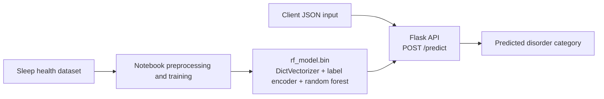

# Sleep Health and Disorder Baseline

## Problem statement

This project is an initial baseline for predicting sleep-related outcomes from health and lifestyle information. The current model predicts the reported **sleep disorder category** (`None`, `Insomnia`, or `Sleep Apnea`); it does not yet predict the numeric sleep-quality rating. The longer-term goal is to use this starting point for more personalized sleep insights.

This is an educational project, not a medical diagnostic tool.

## Dataset and exploration

The notebook uses the Sleep Health and Lifestyle dataset from [Kaggle](https://www.kaggle.com/datasets/uom190346a/sleep-health-and-lifestyle-dataset). It contains 374 records. The `Person ID` field was removed, blood pressure was split into systolic and diastolic measurements, and missing disorder labels were treated as `None`. `Normal Weight` was combined with `Normal`, and occupations with fewer than five records were grouped as `Other`.

Highlights from [`healthnlifstyle.ipynb`](healthnlifstyle.ipynb):

- The target is imbalanced: 58.6% `None`, 20.6% `Insomnia`, and 20.9% `Sleep Apnea`.
- Disorder categories showed different average blood pressure: the no-disorder group averaged about 124/81 mmHg, Insomnia about 132/87, and Sleep Apnea about 138/93.
- Most records in the `Normal` BMI category were labeled `None`; the `Overweight` category had more records labeled Insomnia or Sleep Apnea. The `Obese` group is very small.
- Two derived features were added: pulse pressure (systolic minus diastolic) and sleep duration divided by stress level plus one.
- The notebook reports 242 exact duplicate rows. These duplicates may affect evaluation when rows are randomly split.

## Modeling and metrics

The notebook compares decision trees, random forests, and XGBoost using stratified train/validation/test splits. The serialized serving model is a random forest with 50 trees, maximum depth 3, and minimum leaf size 3. Categorical inputs are one-hot encoded with a fitted `DictVectorizer`.



On the held-out test split of 75 records, the notebook reports:

| Metric | Result |
| --- | ---: |
| Accuracy | 0.92 |
| Macro F1 | 0.89 |
| ROC-AUC (one-vs-rest) | 0.9503 |

These are preliminary results on a small dataset. In particular, exact duplicate rows can appear across splits, so the scores may overstate performance on genuinely new people.

## Run locally

From this directory, install the locked dependencies and start the Flask development server:

```bash
pipenv install --deploy
pipenv run python predict.py
```

The API listens on `http://localhost:9696`.

## Run with Docker

Build and start the container:

```bash
docker build -t sleep-predictor .
docker run --rm -p 9696:9696 sleep-predictor
```

The container serves the API with Gunicorn at `http://localhost:9696`.

## API usage

Send a JSON object with the input fields used to train the model:

```bash
curl -X POST http://localhost:9696/predict \
  -H 'Content-Type: application/json' \
  -d '{
    "gender": "Female",
    "age": 59,
    "occupation": "Nurse",
    "sleep_duration": 8.1,
    "quality_of_sleep": 9,
    "physical_activity_level": 75,
    "stress_level": 3,
    "bmi_category": "Overweight",
    "heart_rate": 68,
    "daily_steps": 7000,
    "systolic": 140,
    "diastolic": 95,
    "pulse_pressure": 45,
    "sleep_per_stress": 2.025
  }'
```

Example response:

```json
{"prediction":"Sleep Apnea"}
```

The prediction is a model classification, not a clinical diagnosis.

## Limitations and next steps

- The dataset is small, class-imbalanced, and contains exact duplicate rows; use deduplication and person-level/grouped splits for more reliable evaluation.
- The model predicts a reported disorder category, not sleep quality or an individual's future health outcome. The dataset may also contain repeated measurements for the same person.
- Input validation, confidence/probability reporting, and clinical review are not implemented.
- Next steps: evaluate on a larger independent dataset, use group-aware validation, investigate class-imbalance handling, and develop a separately defined and validated personalized sleep-quality target.
